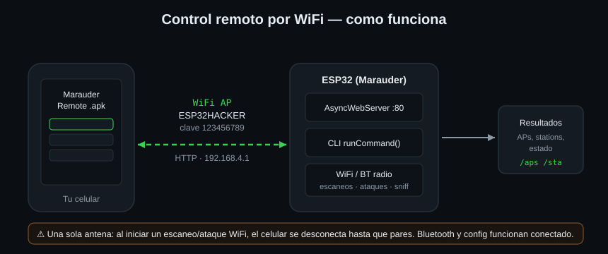
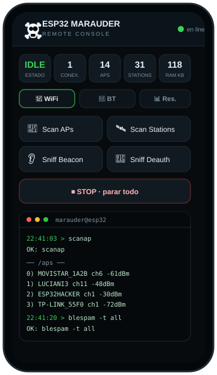

# ESP32 Marauder — Custom Mods 🏴‍☠️

A personal fork of [**ESP32 Marauder v1.20.0**](https://github.com/justcallmekoko/ESP32Marauder)
by *justcallmekoko*, built from source for the **Marauder Kit** board (plain
ESP32‑WROOM + ILI9341 SPI TFT) with three custom additions. All upstream code,
features and the original license are kept intact — this only **adds** on top.

> ⚖️ Use the WiFi/Bluetooth attack features **only** on networks and devices you
> own or are explicitly authorized to test.

---

## 1. Pirate‑skull laughing boot animation

On boot, before the menu loads, the display shows a Jolly‑Roger skull —
crossbones, an eye‑patch and a red eye‑glint — that **opens and closes its mouth
like laughing** (`HA! HA!`).

- Drawn with vector primitives (no bitmap), so it scales to the screen size.
- `Display::drawPirateSkullIntro()` in [`Display.cpp`](esp32_marauder/Display.cpp),
  declared in `Display.h`, called from `setup()` in the main sketch after the
  backlight turns on. Guarded by `#ifdef HAS_FULL_SCREEN`.

## 2. Swipe‑to‑scroll / tap‑to‑select menu navigation

The stock Kit build requires tapping the exact top/middle/bottom zone to move
and select. This mod makes the resistive touch far more forgiving:

- **Swipe up/down** anywhere → move the highlighted item.
- **Tap** anywhere → open the highlighted item.
- A slow drag no longer triggers the brightness‑hold gesture by accident.

Implemented by replacing the menu‑navigation branch in
[`MenuFunctions.cpp`](esp32_marauder/MenuFunctions.cpp) with gesture detection
(`SWIPE_STEP = TFT_HEIGHT/10`). Direction and sensitivity are one constant each.

## 3. Remote Web control + Android app

A new module turns the ESP32 into its own Wi‑Fi access point and serves a
graphical control console to any phone browser — **no internet needed**.

- Creates SoftAP **`ESP32HACKER`** / password **`123456789`**, **auto‑started on
  boot** (and toggled from **Menu → Device → Remote Web**).
- Serves a single self‑contained page (`AsyncWebServer` on port 80) at
  **`http://192.168.4.1`** with:
  - live status chips (state, connected clients, APs, stations, free RAM),
  - tabbed graphical buttons for WiFi / Bluetooth actions,
  - a terminal‑style output panel,
  - a manual command box that runs **any** Marauder CLI command.
- Each button calls `CommandLine::runCommand()`; `/aps` and `/sta` read the live
  `access_points` / `stations` lists so scan results show on the phone.

Files: [`RemoteWeb.h`](esp32_marauder/RemoteWeb.h),
[`RemoteWeb.cpp`](esp32_marauder/RemoteWeb.cpp), plus a CLI command `remoteweb`
and a menu node.

### The Android app

`android/` contains a tiny **WebView wrapper** (`MarauderRemote.apk`) that opens
`http://192.168.4.1` full‑screen so the panel feels like a native app. The
“brains” live on the ESP32; the app is just a shell, so the same UI also works by
opening that address in any mobile browser.

> ⚠️ **Single‑radio limit:** the ESP32 has one 2.4 GHz antenna. When you start a
> **WiFi** scan/attack it takes over the radio and the phone drops off
> `ESP32HACKER` until you reconnect and press **STOP**. **Bluetooth** actions and
> configuration keep working while connected.

---

## How to connect (quick start)

1. Install **`android/MarauderRemote.apk`** on your phone (allow “install from
   unknown sources”), or just use a browser.
2. Power the ESP32 → it creates Wi‑Fi **`ESP32HACKER`**.
3. Phone → **Settings → Wi‑Fi → ESP32HACKER**, password **`123456789`**
   (accept “stay connected, no internet”).
4. Open the **Marauder Remote** app (or browse to `http://192.168.4.1`).

---

## Building from source (Marauder Kit)

Reproduces the upstream CI recipe for the Kit target:

- Arduino **esp32 core 3.3.4**, FQBN `esp32:esp32:d32:PartitionScheme=min_spiffs`,
  build flag `-DMARAUDER_KIT`.
- `TFT_eSPI` V2.5.34 configured with `User_Setup_og_marauder.h`; NimBLE 2.3.8 and
  the other libraries pinned exactly as in `.github/workflows/build_parallel.yml`.
- `platform.txt` patched with `-Wl,-zmuldefs`; esp32‑arduino‑libs `cpp_flags`
  switched to `-fno-exceptions`.
- Flash the resulting `esp32_marauder.ino.bin` to **`0x10000`** at 115200 baud.

The Android APK is built without Gradle using the Android SDK build‑tools
(`aapt2` → `javac` → `d8` → `zipalign` → `apksigner`); see `android/`.

---

*Credit: based on the excellent [ESP32 Marauder](https://github.com/justcallmekoko/ESP32Marauder)
by justcallmekoko. This fork keeps the original GPL‑3.0 license.*
